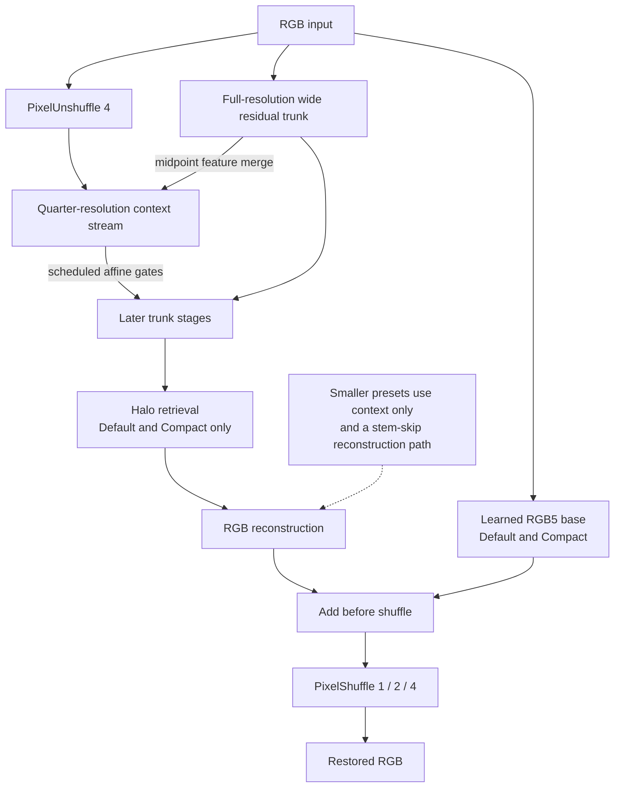
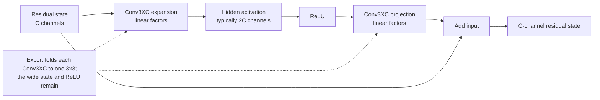
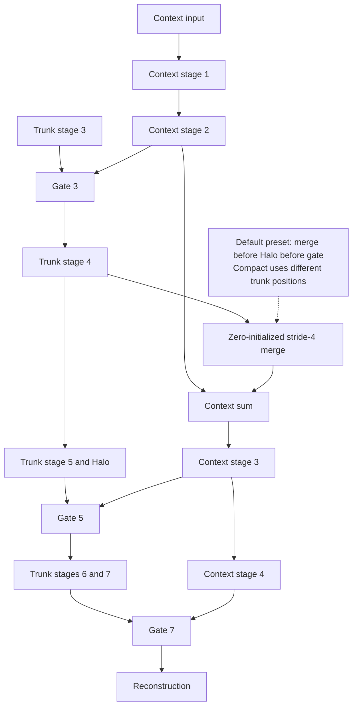
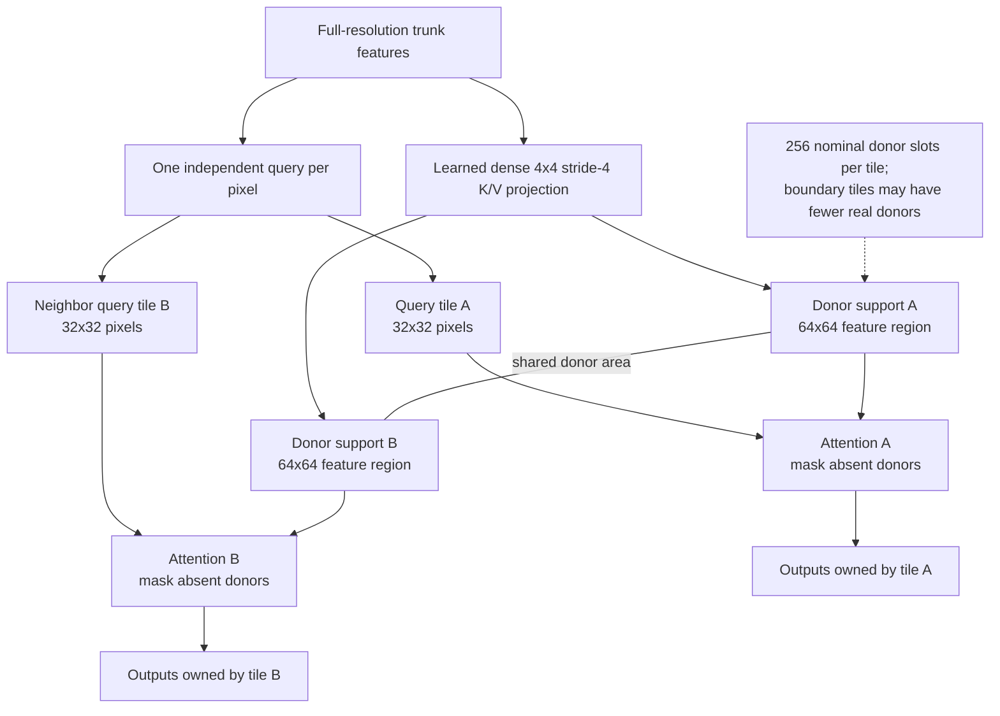
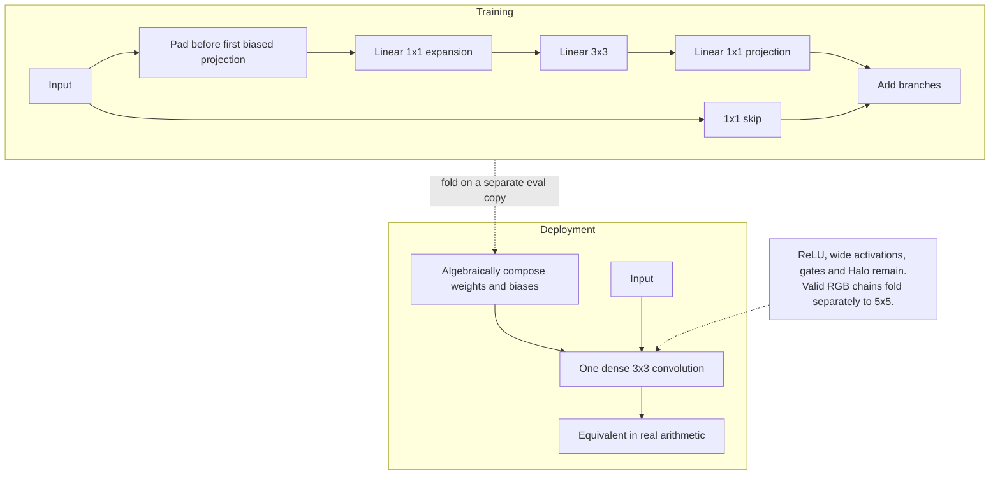

# WSR: Wide Residual Super-Resolution with Multiscale Context and Halo Retrieval

Rift73 | Technical report | 29 October 2026

[Typeset paper (PDF)](WSR.pdf) · [Architecture](wsr_arch.py) · [License](LICENSE)

Diagrams are embedded below; the PDF contains the typeset figures.

### Abstract

WSR combines a full-resolution wide residual trunk with a quarter-resolution context stream. The context stream reads pixel-unshuffled RGB, receives a midpoint feature merge, and modulates the trunk through scheduled channel-wise gates. Default and Compact additionally use Halo retrieval: independent pixel queries attend to learned block keys and values over overlapping 64 x 64 donor supports, while each query belongs to a 32 x 32 tile. Linear Conv3XC branches expand the training parameterization and fold into dense convolutions for deployment. Two linear RGB chains in the attention-enabled backbone fold to 5 x 5 kernels. Five presets support native 1x, 2x, and 4x output. This report defines the current consolidated architecture, including boundary masks, staged initialization, folding, and numerical contracts. It is an implementation description, not a new empirical quality or speed comparison.

*Figure 1. Attention-enabled WSR. The context stream runs at one-quarter spatial resolution; gates modulate the full-resolution trunk. Smaller presets retain context but omit Halo and use a different reconstruction backbone.*

### 1  Design rationale

A narrow residual state can coexist with a wider nonlinear transformation [1]. WSR applies that idea with foldable linear projections, then introduces two complementary context mechanisms: coarse spatial conditioning and content-selected Halo donors. Coarse features need not preserve every high-frequency detail because the trunk retains the original LR grid. Halo adds nonlocal selection within bounded support without pooling the queries.

The current WSR is the consolidated Halo design. Earlier experimental alternatives are not part of this release. The architecture is single-image, not temporal. It contains no optical flow, discriminator, teacher model, or fixed GAN objective. All diagrams are original schematics rather than measured activations or restoration examples.

## 2  Presets and full-resolution trunk

| Preset | C | Hidden | Depth | Gates | Heads | Context |
|---|---|---|---|---|---|---|
| Default | 64 | 128 | 7 | 3 | 2 | 64 |
| Compact | 32 | 64 | 9 | 3 | 1 | 64 |
| UltraCompact | 32 | 64 | 5 | 2 | - | 64 |
| SuperUltraCompact | 16 | 32 | 5 | 2 | - | 32 |
| Mobile | 8 | 16 | 2 | 1 | - | 32 |

Table 1. Five released presets. Context is the context-stream channel width. Only Default and Compact use Halo attention. Every preset supports scale in {1,2,4}.

### 2.1  Wide residual processing

A standard trunk block maps C channels to a wider hidden state, applies ReLU, projects back to C, and adds the input. Each projection is a linear gain-two Conv3XC module. There are two different expansions: the architectural hidden width around ReLU, and the internal factor widths inside Conv3XC. The former remains at inference; the latter folds away.

*Figure 2. Two distinct width expansions in a standard wide residual block. The hidden activation state remains at inference; the internal linear factors of each Conv3XC are composed away. The first attention-enabled trunk stage is specialized as described below.*

WRB(z) = z + P(ReLU(E(z))).   (1)

In the attention-enabled WESR class, the first stage is specialized: stem(x) + first_project(ReLU(first_expand(x))). first_expand is a linear effective-5x5 RGB projection; the remaining depth-1 stages are ordinary wide residual blocks. Thus the listed depth counts trunk stages, not Conv3XC modules. The context stream always contains four additional residual blocks, each with hidden width equal to context width.

### 2.2  Reconstruction differs between families

Default and Compact add a learned 5 x 5 RGB base to the trunk reconstruction in pre-shuffle channel space. Both produce 3s² channels, followed by one PixelShuffle(s). The three smaller presets use WideContextSR: a shallow stem skip is added after a deep trunk projection, followed by reconstruction and pixel shuffle. They do not simply disable the attention flag in the larger backbone.

Attention-enabled: y = PSs(Wrec z + RGB5base(x)).   (2)
Context-only: y = PSs(Wrec(Wdeep z + stem(x))).   (3)

For B x 3 x H x W input, the output is B x 3 x sH x sW. WSR applies neither a fixed mean subtraction nor output clipping. Internal right/bottom padding supports arbitrary positive image sizes without resizing the input to a window multiple. Scale-one preserves external dimensions; it is still a learned restoration mapping, not an identity guarantee.

Factories: wsr, wsr_compact, wsr_ultracompact, wsr_superultracompact, and wsr_mobile. Head weights depend on the requested scale; one checkpoint is not automatically interchangeable across 1x/2x/4x.

## 3  Quarter-resolution context and gating

The context input is formed by zero-padding RGB on the right and bottom to multiples of four and applying PixelUnshuffle(4). This creates 48 channels at ceil(H/4) x ceil(W/4), retaining the sixteen RGB phases as channels rather than averaging them. A Conv3XC stem and ReLU precede four context residual blocks. Only the first two are evaluated before the midpoint trunk merge.

c1 = WRB1(ReLU(Sc(PU4(pad(x)))))
c2 = WRB2(c1)
c3 = WRB3(c2 + M4,stride4(pad(zm)))
c4 = WRB4(c3),   m=floor(D/2)+1.   (4)

The merge is a dense learned 4 x 4 stride-four convolution, initialized to zero. It sees the trunk at the merge position before that position's attention or gate. Later context blocks therefore incorporate trunk information only through this explicit path, and a gate is not permitted to consume a future context stage.

*Figure 3. Causal context dependencies in Default WSR. The first gate reads context stage 2, before the midpoint merge; the later gates read trunk-conditioned stages 3 and 4. Compact uses the same context-stage choices at different trunk positions.*

### 3.1  Scheduled affine modulation

For D trunk stages and S gates, gate positions are pj=ceil(jD/S), j=1...S. The corresponding zero-based context index is qj=ceil(4pj/D)-1. A pointwise projection produces gamma and beta, bilinearly upsampled by four with align_corners=False and cropped to the trunk extent. The output is:

Gate(z,c) = z ⊙ [2 sigmoid(γ(c) + a ⊙ z)] + β(c).   (5)

The projection weights, projection bias, and per-channel local coefficient a start at zero. Since 2 sigmoid(0)=1, the initial gate is identity. This is a bounded multiplicative gain, not a hard mask; beta provides an additive path. With zero projection weights, the gate initially sends no data gradient back into context features, although its output projections can learn. Opening these paths is part of the initialization, not evidence that every component learns on the first update.

| Preset | Merge | Gate stages | Context stages* | Halo stage |
|---|---|---|---|---|
| Default | 4 | 3, 5, 7 | 2, 3, 4 | 5 |
| Compact | 5 | 3, 6, 9 | 2, 3, 4 | 6 |
| Ultra / SuperUltra | 3 | 3, 5 | 3, 4 | None |
| Mobile | 2 | 2 | 4 | None |

Table 2. Derived scheduling for the released presets. *Context stages are displayed one-based; code indices are zero-based. At a shared position: merge first, then Halo if present, then gate.

Bilinear context interpolation and stride-four phase packing are part of the finite-image function. Cropped or independently tiled evaluation can change this function near tile boundaries.

## 4  Halo retrieval with independent queries

Halo-style attention extends donor support beyond a query block [3]. WSR uses one query per trunk pixel and a dense 4 x 4 stride-four projection for keys and values. For each 32 x 32 query tile, donors occupy a 64 x 64 feature region with a nominal 16-pixel margin. Adjacent tiles share donors. The block-token representation is learned, not fixed average pooling, and receives already-contextualized trunk features.

*Figure 4. Two neighboring 32 x 32 query tiles share donor regions. Each uses a 64 x 64 feature support encoded as 16 x 16 learned block tokens. Outputs are not overlap-blended.*

Default uses two heads and Compact one; both have head width 32. Each head allocates 31 dimensions to normalized cosine content and one dimension to a validity-mask lane. Query vectors are projected independently, normalized with ε=10-6, and multiplied by a per-head temperature initialized to 10 and capped at 100. Key content is normalized in the same way.

q'=[τ q̂, 1],   k'=[k̂, m],   m ∈ {0, -10000}
O = softmax(q'k'T) V.   (6)

Real coarse tokens have m=0; absent donor slots have m=-10000 and zero values. Keys/values are first computed from feature maps padded to multiples of four. A partially filled real coarse cell remains valid; it is not treated as wholly absent. Queries are padded to a multiple of 32 for execution, then restored and cropped. The donor packing order is shared by K, V, and mask.

Each tile has 256 nominal donor slots, but border and small-image tiles can contain fewer real keys. On a 64 x 64 feature map, each of the four query tiles has 144 valid keys. Interior large-image tiles can use all 256. Halo therefore does not make training and inference support identical, and shared support does not eliminate the discontinuity where query ownership changes.

Only the value rows of the K/V projection start at zero. The attention residual initially vanishes. Q/K matching receives no gradient through a zero value field until the value path opens; nonzero later gradients still depend on data and upstream loss.

## 5  Conv3XC and exact linear folding

Conv3XC is carried from the SPAN implementation lineage [2]. It sums a 1 x 1 skip and a linear 1x1-3x3-1x1 branch. WSR uses gain two: the first projection expands the input-channel count by two and the middle projection produces twice the final output-channel count. There is no activation inside these projections. In training, both branches execute on feature maps. Linear branch composition is an instance of structural reparameterization [4].

*Figure 5. Conv3XC training and deployment forms. The independent wide residual activation in (1) remains after folding. Linear composition changes execution, not the surrounding architecture.*

Let A, Buv, C denote first pointwise, middle spatial, and last pointwise weights, with biases a, b, c. Let S and d denote the pointwise skip. The equivalent dense kernel and bias are:

Wuv = C Buv A + δu0,v0 S
beff = C[(Σuv Buv)a + b] + c + d.   (7)

The boundary rule is essential. The training path zero-pads the input before the first biased pointwise projection, then applies the middle convolution without padding. Thus padded features include the first projection's bias, and (7) remains valid at borders. Padding the intermediate features with zeros after that projection would generally define a different operator.

### 5.1  Effective 5 x 5 RGB paths

Default and Compact contain two FoldableRGB5 modules: one feeds the first wide expansion and one supplies the additive reconstruction base. Each composes two valid 3 x 3 Conv3XC operators after a single two-pixel input pad. The skip in a valid operator is cropped by one pixel. No intermediate nonlinearity is present, so the full chain folds to a single 5 x 5 convolution. This rule is not a license to fuse arbitrary separately padded convolution chains.

Export composition uses FP64 before casting back to the source dtype. The larger training parameterization disappears, but trained wide features around ReLU, gates, context, and Halo remain. The algebra does not guarantee a quality improvement from reparameterization, bitwise FP16/BF16 parity, or any particular engine speedup. The optimization trajectory differs from training the folded weights directly.

## 6  Precision, deployment, and limitations

### 6.1  Three execution states

| State | Conv3XC / RGB chains | Halo scores |
|---|---|---|
| Training | Explicit linear branches; gradients on factors | At least FP32 score accumulation and softmax |
| Ordinary eval | Conv3XC refreshes cached kernel; RGB chain remains explicit | At least FP32, as in training |
| Prepared export | Static 3x3/5x5 convolutions; factors removed | Model-dtype matmul/softmax; cached temperature |

Table 3. Evaluation alone is not the same as permanent export preparation. The export score policy deliberately permits a different low-precision evaluation path.

During non-deployed attention, Q/K score arithmetic and softmax use a dtype promoted with FP32 and autocast disabled; probabilities are then cast to the value dtype. Export caches the clamped temperature and executes the matmul-softmax-matmul expression in model dtype. This supports low-precision backend optimization but is not a claim of identical numerical results. Validate the selected precision and engine against the appropriate reference.

Call eval() on a separate model copy before prepare_for_export(). This folds the linear branches in place and marks attention deployed; it is idempotent but not reversible. Keep the unfolded checkpoint and optimizer state for training. The method does not build an ONNX graph or TensorRT engine. The release contains no engine/plugin and makes no hardware-specific throughput promise.

### 6.2  Integration and checkpoint scope

wsr_arch.py includes Conv3XC and the attention/context components. It is drop-in architecture code for traiNNer, not a bundled trainer: its registry import requires traiNNer.utils.registry. Copy it into traiNNer/archs, avoid duplicate modules registering the same names, and select the matching factory and scale. Loading strictly is appropriate for matching unfolded checkpoints. Folded states require the corresponding deployment structure, not the original training module.

### 6.3  Boundaries and evidence

Learned 4 x 4 K/V tokens compress information; independent queries do not recover information that the projections discard. Coarse context adds spatial conditioning but is not an image-wide attention map. Halo retains query-tile support changes and variable valid-key counts. PU4, convolution padding, context interpolation, and tile alignment affect finite-image behavior. These mechanisms do not prove freedom from GAN artifacts, ringing, or texture hallucination.

No new training, quality benchmark, GPU experiment, or timing study was performed for this report. A future comparison must fix the degradation, crop, effective batch, optimizer, losses, schedule, seed policy, and validation convention. Runtime evidence must state precision, folded state, image shape, batch, hardware, backend, warmup, and timing scope. Parameter count and MAC count are not latency measurements.

## 7  Implementation map

| Source component | Responsibility |
|---|---|
| Conv3XC / _fold_conv3xc | Training branches and static 3x3 composition |
| ValidConv3XC / FoldableRGB5 | Valid RGB chains and 5x5 export |
| WideResidualBlock | Wide nonlinear trunk/context transform |
| ContextGate | Identity-initialized coarse affine modulation |
| BlockTokenAttention | Fine queries, Halo donor packing, mask lane |
| WESR | Default/Compact trunk, context, Halo, RGB base |
| WideContextSR | Three context-only presets |
| Registered factories | Fixed geometry with scale-dependent heads |

Table 4. The file is organized in dependency order: linear components, context, Halo, complete backbones, then registered presets.

### Release scope

The accompanying source is the current five-preset WSR family. It includes no Wide13, EDBB, or K6/V4 experimental variant, no pretrained weights, and no private dataset paths. Documentation describes the shipped behavior without promoting discarded experiments into supported features. The paper and readable text are versioned together with the code.

Author: Rift73. Documentation and original schematic preparation were assisted by Codex, with a visual-design review by Claude Opus 5.5. This paper contains the architecture explanation, diagrams, and integration notes; applicable code notices are consolidated in LICENSE.

### References

[1] J. Yu et al. Wide Activation for Efficient and Accurate Image Super-Resolution. 2018. [arXiv:1808.08718](https://arxiv.org/abs/1808.08718). Wide activation is a conceptual antecedent; WSR does not reproduce the WDSR model or its measurements.

[2] C. Wan et al. Swift Parameter-free Attention Network for Efficient Super-Resolution. 2023. [arXiv:2311.12770](https://arxiv.org/abs/2311.12770); [official SPAN code](https://github.com/hongyuanyu/SPAN). Conv3XC implementation lineage, carried through spandrel/traiNNer integration.

[3] A. Vaswani et al. Scaling Local Self-Attention for Parameter Efficient Visual Backbones. CVPR, 2021. [arXiv:2103.12731](https://arxiv.org/abs/2103.12731). Halo-style donor support; WSR uses learned coarse K/V tokens rather than claiming to reproduce HaloNet.

[4] X. Ding et al. Diverse Branch Block: Building a Convolution as an Inception-like Unit. CVPR, 2021. [arXiv:2103.13425](https://arxiv.org/abs/2103.13425). General structural-reparameterization background; WSR uses Conv3XC, not EDBB.
